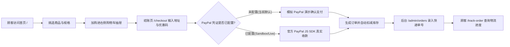

# 📮 StampsBox 风格独立站全栈系统 — 新手保姆级使用说明书

> 这是一套**开箱即用**的跨境电商独立站（前台商城 + 后台管理系统）全栈项目，视觉风格参考 [StampsBox](https://www.stampsbox.com/) 打造。  
> **不需要懂复杂运维、不需要额外安装 MySQL/Redis**——只要电脑装了 Node.js，几条命令就能在本地跑起一整套能逛、能加购、能拖拽装修、能管理商品和订单、并已预留 PayPal 支付接口的独立站！

---

## 目录
1. [这个项目能干什么？（小白功能说明书）](#一这个项目能干什么小白功能说明书)
2. [页面布局一览（前台 + 后台结构图）](#二页面布局一览前台--后台结构图)
3. [保姆级启动方式（5 分钟跑起来）](#三保姆级启动方式5-分钟跑起来)
4. [老板/运营日常操作指南](#四老板运营日常操作指南)
5. [PayPal 真实收款对接指南（预留接口激活）](#五paypal-真实收款对接指南预留接口激活)
6. [项目目录结构与技术栈](#六项目目录结构与技术栈)
7. [新手常见问题排查（FAQ）](#七新手常见问题排查faq)

---

## 一、这个项目能干什么？（小白功能说明书）

整个网站分成两大部分：**「给顾客逛的前台商城」** 和 **「给店主用的后台管理系统」**，所有数据都会自动保存在本地 SQLite 数据库里（重启电脑也不会丢）。

### 1. 前台商城（顾客看到的页面）
| 功能模块 | 顾客能做什么 |
| :--- | :--- |
| **动态装修首页** | 浏览顶部促销公告栏、大屏焦点轮播图、分类快捷入口、按分类筛选商品、阅读邮票指南文章、查看品牌背书。首页展示什么内容、什么顺序，完全由你在后台拖拽决定！ |
| **商品分类与搜索** | 点击顶部导航或分类卡片进入分类页，支持按 **默认 / 销量热度 / 最新上架 / 价格从低到高 / 价格从高到低** 排序；点击右上角放大镜可实时搜索商品。 |
| **商品卡片快捷交互** | 鼠标移到商品图上会出现 **「快速预览（小眼睛）」** 弹窗和底部滑出的 **「QUICK ADD 一键加购」** 按钮，不用跳转页面就能挑选规格下单。 |
| **商品详情页 (PDP)** | 支持多图切换、**多规格/包装选择**（例如 `Book of 20`、`1 Roll / 100 Pcs`、`5 Rolls / 500 Pcs`，每个规格有独立价格和库存）、数量增减、一键分享、商品提问表单、物流与 30 天退货保障卡片、相关推荐。 |
| **滑出式购物车抽屉** | 加购后右侧滑出购物车，内置 **满额包邮动态进度条**（默认满 `$49.99` 包邮，后台可改），随时修改数量或删除商品。 |
| **结账与优惠码 + PayPal** | 填写收货地址、选择标准/加急物流、输入优惠码（内置 `WELCOME10` 打 9 折、`SAVE5` 满 `$40` 减 `$5`），通过 PayPal 完成下单（未配置商户凭证时自动提供 **模拟 PayPal 演示支付** 让你体验完整流程）。 |
| **订单物流追踪** | 顾客在 `/track-order` 输入订单号和邮箱，即可查看 5 步履约进度条（待支付 → 已支付 → 处理中 → 已发货 → 已送达）及 USPS 快递单号。 |
| **资讯、FAQ 与客服留言** | 浏览 Stamp Guide 博客文章、常见问题解答、关于我们、退换货政策，或通过 Contact Us 提交咨询（直接进入你的后台收件箱）。 |

### 2. 管理后台（店主/运营使用的控制台 `/admin`）
| 后台菜单 | 你能做什么 |
| :--- | :--- |
| **📊 数据概览 (Dashboard)** | 一眼看清总营收、待发货订单数、在售/草稿/下架商品数、近 7 天营收柱状图、低库存规格预警（库存 ≤ 25 自动提醒）、未读客户留言以及 PayPal 支付接入状态。 |
| **🎨 拖拽布局装修 (Page Builder)** | **核心亮点！** 像搭积木一样通过鼠标拖拽调整首页各模块顺序；支持新增促销横幅/信任徽章等模块、隐藏/复制/删除模块、编辑文字配色与上传轮播图，并支持 **桌面端 / 手机端实时预览**，满意后一键发布生效。 |
| **🧭 导航与栏目页面 (Menus & Pages)** | **完全自定义顶部导航栏**：支持拖拽调整顶部栏目顺序、增删改名称与链接、设置分类下拉菜单；并可编辑 `About Us`、政策页或新建任意自定义栏目页面，一键挂载到顶部导航。 |
| **📦 商品管理 (Products)** | 上传新商品、编辑详情、多图上传、配置多个规格（不同包装对应不同价格和库存）、**一键上架 / 下架 / 设草稿**、批量上下架或删除、点亮星标设为热销（Best Seller）。 |
| **🗂️ 分类管理 (Categories)** | 新增/编辑/删除商品分类、上传分类封面图、控制是否在前台隐藏，支持 **直接拖拽调整分类顺序**（首页、筛选胶囊、顶部菜单、页脚实时同步）。 |
| **🧾 订单管理 (Orders)** | 查看每笔订单的商品明细、收货地址和 PayPal 流水号；修改订单状态（已支付/处理中/已发货/已送达/退款等），并填写物流承运商和快递单号。 |
| **📣 营销与内容 (Coupons & CMS)** | 创建折扣码/满减券、发布 Stamp Guide 博客文章、管理 FAQ 问答、回复客户留言、查看并 **一键导出 CSV 邮件订阅名单**。 |
| **🖼️ 媒体素材库 (Media Library)** | 集中上传并管理所有商品图和 Banner 图，一键复制图片路径。 |
| **⚙️ 支付与站点设置 (Settings)** | **预留 PayPal REST API v2 配置面板**（支持测试连通性）；上传更换 **左上角网站 Logo 与浏览器 Favicon**；修改店铺名称、底部邮箱/电话/地址/社媒链接、包邮门槛、运费金额、顶部公告栏轮播文案及管理员密码。 |

---

## 二、页面布局一览（前台 + 后台结构图）

### 1. 前台首页整体布局（参考 StampsBox，支持后台拖拽重排）

```text
+-----------------------------------------------------------------------------+
|  [顶部深色公告栏 #232323]   <  Free shipping on orders of $49.99 or more  >  |
+-----------------------------------------------------------------------------+
|  [吸顶白色导航栏]  StampsBox Logo   Home | Best Seller | Forever Stamps v   |
|                    Stamp Guide | About Us | FAQ      [搜] [查单] [Admin] [袋]|
+-----------------------------------------------------------------------------+
|  [1. 焦点图分屏 Hero 模块]                                                  |
|  +-----------------------------------------------------------------------+  |
|  |                     全宽高清平拍大图（支持淡入淡出切换）                |  |
|  +-----------------------------------------------------------------------+  |
|  | 深海军蓝底部控制栏 (#17263B)                                            |  |
|  | FEATURED COLLECTION        [US Flag]  [Flowers]  [Love]      [<] [>]  |  |
|  | US FLAG STAMPS (Georgia)   ─────────  ─────────  ──────               |  |
|  | 简介文案 · Shop collection ->                                           |  |
|  +-----------------------------------------------------------------------+  |
+-----------------------------------------------------------------------------+
|  [2. 分类宫格 Shop by Category] (桌面 4 列 / 平板 3 列 / 手机 2 列)           |
|     [ 1:1 圆角卡片 ]   [ 1:1 圆角卡片 ]   [ 1:1 圆角卡片 ]   [ 1:1 圆角卡片 ] |
|     Animals & Nature    Celebrations        Flowers           Holiday       |
+-----------------------------------------------------------------------------+
|  [3. 商品筛选陈列 Product Showcase]                                          |
|       (All)  [Best Seller 激活红框]  (Flowers)  (Love)  (Patriotic) ...      |
|   +--------+  +--------+  +--------+  +--------+  +--------+ (桌面 5 列)    |
|   | 1:1图  |  | 1:1图  |  | 1:1图  |  | 1:1图  |  | 1:1图  |                |
|   |QUICKADD|  |        |  |        |  |        |  |        |                |
|   | 标题   |  | 标题   |  | 标题   |  | 标题   |  | 标题   |                |
|   |From $X |  |  $XX   |  |  $XX   |  |  $XX   |  |  $XX   |                |
|   +--------+  +--------+  +--------+  +--------+  +--------+                |
|                         [  VIEW ALL STAMPS 按钮  ]                           |
+-----------------------------------------------------------------------------+
|  [4. 邮票指南 Stamp Guide] (3 列 3:2 图文卡片 + Read more ↗)                 |
|  [5. 品牌背书 Brand Story] (居中 820px 信任介绍文案 + READ MORE 按钮)         |
|  *(还可在后台拖拽添加：促销活动横幅 Promo Banner / 4列信任保障徽章)*          |
+-----------------------------------------------------------------------------+
|  [深黑页脚 #111111]  品牌地址与社媒 | 商品分类 | 常用链接 | 邮件订阅+支付图标  |
+-----------------------------------------------------------------------------+
   *(手机端底部自动固定显示 4 格导航栏：Shop | Cart(红点) | Orders | Search)*
```

### 2. 商品详情页布局 (`/product/:slug`)

```text
首页 / 分类名 / 商品标题
+-----------------------------------+  +------------------------------------+
| [小图1]  +---------------------+  |  | 商品主标题 H1 (34px)               |
| [小图2]  |                     |  |  | ~~$15.99~~  $12.75 (醒目正红)      |
| [小图3]  |   1:1 棚拍主图区     |  |  |                                    |
|          |   (< 左右切换 >)     |  |  | Choose a Format:                   |
|          +---------------------+  |  | [Book of 20 皇家蓝选中] [1 Roll]   |
|                                   |  | Quantity:  ( -  1  + )             |
|                                   |  | [     Add to cart – $12.75     ]   |
|                                   |  | [      Buy Now with PayPal     ]   |
|                                   |  | ? Ask a question    ↗ Share        |
|                                   |  | +--------------------------------+ |
|                                   |  | | 🚚 预计 1-5 天 First-Class送达  | |
|                                   |  | | ↩ 30 天原包装无忧退货          | |
|                                   |  | +--------------------------------+ |
|                                   |  | VISA | MC | AMEX | DISCOVER | PP   |
+-----------------------------------+  +------------------------------------+
  [ Description ]   [ Return Policies ]   (下方附带 4 列相关商品 + 滚动悬浮加购条)
```

### 3. 管理后台与拖拽装修器布局 (`/admin/builder`)

```text
+---------------+-------------------------------------------------------------+
| 深蓝侧边栏     | 顶部操作条：[拖拽编排 | 实时预览] [恢复默认] [保存并发布]    |
| #17263B       +---------------+-----------------------+---------------------+
|               | 左侧：组件库   | 中间：可拖拽首页画布   | 右侧：属性编辑器    |
| · 数据概览     | + 焦点图轮播   | ⠿ Hero Slider  👁📋🗑 | 标题 / 副标题       |
| · 拖拽布局装修 | + 分类宫格     | ⠿ Category Grid👁📋🗑 | 桌面端列数          |
| · 商品管理     | + 商品筛选陈列 | ⠿ Product Grid 👁📋🗑 | 默认筛选标签        |
| · 分类管理     | + 活动横幅     | ⠿ Stamp Guide  👁📋🗑 | 轮播图本地上传      |
| · 订单管理     | + 资讯指南     | ⠿ Brand Story  👁📋🗑 | 背景色 / 跳转链接   |
| · 营销与内容   | + 品牌故事     |                       |                     |
| · 媒体素材库   | + 信任保障条   | (按住 ⠿ 即可上下拖动) | (修改即刻实时生效)  |
| · 支付与设置   |               |                       |                     |
+---------------+---------------+-----------------------+---------------------+
```

### 4. 核心购物与后台交互流程



---

## 三、保姆级启动方式（5 分钟跑起来）

### 第 1 步：确认电脑已安装 Node.js
本项目使用 Node.js 内置的 SQLite 模块（无需装任何数据库软件），请确保 **Node.js 版本 ≥ v22.5**（推荐 **v24 LTS**）。  
打开终端（Windows 可用 PowerShell 或 CMD，Mac 用 Terminal）输入：

```bash
node -v
```
如果显示类似 `v24.x.x` 就说明没问题；如果提示找不到命令，请先到 [Node.js 官网](https://nodejs.org/) 下载安装。

### 第 2 步：下载代码并安装依赖

```bash
# 1. 克隆仓库到本地
git clone https://github.com/sssjack/Storefront.git
cd Storefront

# 2. 一键安装根目录、后端(server)和前端(client)的全部依赖
npm run install:all
```

### 第 3 步：准备环境变量文件（可选，跳过也能直接运行）
```bash
# Windows PowerShell
Copy-Item server\.env.example server\.env

# Mac / Linux
cp server/.env.example server/.env
```
> 即使不复制 `.env`，系统也会使用内置默认配置安全启动，并在首次运行时自动创建数据库 `server/data/storefront.db` 及演示数据（8 个分类、10 款邮票商品、3 篇文章、5 条 FAQ、2 个优惠码、3 笔演示订单）。

### 第 4 步：启动网站（两种模式任选其一）

#### 方式 A：生产单端口模式（推荐给小白直接体验，最省心！）
```bash
# 打包前端页面
npm run build

# 启动服务
npm start
```
启动成功后，直接用浏览器打开：
- **前台商城**：http://localhost:4000
- **后台管理**：http://localhost:4000/admin

#### 方式 B：开发热更新模式（适合边改代码边实时看效果）
```bash
npm run dev
```
该命令会同时启动后端接口（`:4000`）和前端 Vite 服务（`:5173`），用浏览器打开：
- **前台商城**：http://localhost:5173
- **后台管理**：http://localhost:5173/admin

### 默认测试信息速查
- **后台登录账号**：`admin@stampsbox.local`
- **后台登录密码**：`admin123`
- **前台测试优惠码**：`WELCOME10`（9 折）、`SAVE5`（满 `$40` 减 `$5`）
- **前台订单追踪演示**：打开 `/track-order`，输入订单号 `SB-2026-1042` 与邮箱 `emily.carter@example.com`

---

## 四、老板/运营日常操作指南

1. **拖拽修改首页布局**
   - 登录后台 → 点击左侧 **「拖拽布局装修」**；
   - 按住中间卡片左侧的 `⠿` 手柄上下拖动，即可调换首页板块顺序；
   - 想增加一个大促横幅？点击左侧组件库的 **「活动横幅 Promo Banner」**，然后在右侧改文字和颜色；
   - 点击顶部 **「实时预览」** 可分别检查电脑端和手机端效果，满意后点 **「保存并发布」**，前台刷新立即可见！
2. **上传新商品 / 一键下架**
   - 点击 **「商品管理」** → 右上角 **「上传新商品」**；
   - 上传商品图片，点击 **「+ 添加规格选项」** 设置不同包装（如 `Book of 20`、`$12.99`、库存 `100`）；
   - 在商品列表中，直接点击状态胶囊（`已上架` / `已下架`）即可一秒完成上下架切换。
3. **调整商品分类顺序**
   - 点击 **「分类管理」**，按住 `⠿` 手柄拖动即可重排分类，系统会自动保存并同步更新前台导航与首页宫格。

---

## 五、PayPal 真实收款对接指南（预留接口激活）

目前系统在没有商户支付信息时，默认处于 **Demo 模拟演示模式**，你可以放心在前台结账页完整测试下单支付。

当你准备好真实 PayPal 收款账号后，按以下 3 步即可零代码上线：

1. 登录 [PayPal Developer Dashboard](https://developer.paypal.com/)，进入 **Apps & Credentials** 创建一个 REST API App，复制 **`Client ID`** 和 **`Client Secret`**。
2. 进入本站后台 **「支付与站点设置」 → 「PayPal 支付对接（预留）」**：
   - 将 **运行环境 Mode** 切换为 **`Sandbox（测试沙盒）`** 或 **`Live（正式生产）`**；
   - 粘贴你的 `Client ID`、`Client Secret`（以及可选的 `Webhook ID`）；
   - 点击 **「保存 PayPal 配置」**，再点击 **「检测凭证连通性」** 验证 OAuth2 令牌是否通过。
3. 验证通过后，前台 `/checkout` 结账页会自动加载官方 PayPal JavaScript SDK，并渲染真实的 **PayPal Smart Payment Buttons**！

> **后端已预留的全部 PayPal REST API v2 接口**（位于 `server/src/paypal.js` 与 `server/src/routes/public.js`）：
> - `POST /api/payments/paypal/create-order`：服务器端安全创建 PayPal 订单（防前端篡改金额）
> - `POST /api/payments/paypal/capture-order`：捕获扣款、更新订单为已支付并自动扣减对应规格库存
> - `POST /api/payments/paypal/webhook`：异步回调接收端点（支持 `PAYMENT.CAPTURE.COMPLETED` / `REFUNDED`）

---

## 六、项目目录结构与技术栈

```text
Storefront/
├── package.json                 # 根目录一键脚本 (dev / build / start / install:all)
├── README.md                    # 本说明书
├── client/                      # 前端应用 (React 19 + TypeScript + Vite + Tailwind CSS v4)
│   └── src/
│       ├── components/store/    # 前台组件：顶栏页脚、商品卡、购物车抽屉、快速预览、动态区块渲染器
│       ├── pages/store/         # 前台页面：首页、分类页、详情页、购物车、PayPal结账、查单、博客FAQ
│       ├── pages/admin/         # 后台页面：数据概览、拖拽装修器、商品/分类/订单/营销CMS/素材库/设置
│       └── context/             # 全局站点配置与购物车状态管理
└── server/                      # 后端服务 (Node.js + Express + 原生 SQLite + JWT + Multer)
    ├── .env.example             # 环境变量模板（含 PayPal 预留配置项）
    ├── uploads/seed/            # 内置高清 Hero 与商品棚拍示例图片
    └── src/
        ├── index.js             # Express 服务入口与静态资源托管
        ├── db.js                # SQLite 建表与初始化演示数据
        ├── auth.js              # 管理员密码加盐哈希与 JWT 登录鉴权
        ├── paypal.js            # PayPal REST API v2 封装（真实/演示双模式无缝切换）
        └── routes/
            ├── public.js        # 前台商城与 PayPal 结账接口
            └── admin.js         # 后台全模块管理接口
```

---

## 七、新手常见问题排查（FAQ）

- **Q：启动时提示 `Cannot find module 'node:sqlite'`？**  
  A：说明本地 Node.js 版本偏低，请升级至 **Node.js v22.5+ 或 v24 LTS** 后重试。
- **Q：端口 `4000` 被占用了怎么办？**  
  A：打开 `server/.env`，把 `PORT=4000` 改成其他端口（如 `PORT=4001`）重新启动即可。
- **Q：我想清空测试数据、恢复刚装好时的初始状态怎么办？**  
  A：先停止服务，删掉 `server/data/storefront.db` 文件再重新启动，系统会自动重新生成干净的初始演示数据。
- **Q：修改了前端代码，为什么 `npm start` 后页面没变？**  
  A：生产模式（`npm start`）读取的是打包文件，改完前端后需要重新执行一次 `npm run build`；平时改代码建议直接用 `npm run dev` 热更新。
